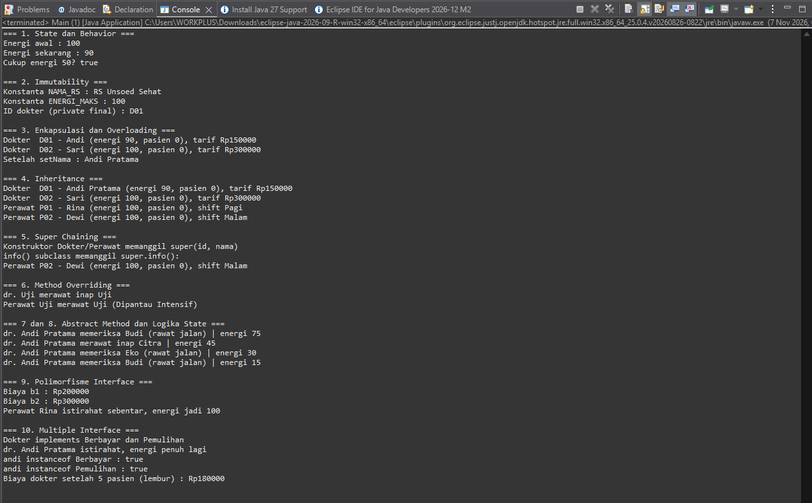

# Sistem Tenaga Medis Rumah Sakit

Responsi Akhir Praktikum Pemrograman Berorientasi Objek
Jurusan Informatika, Fakultas Teknik, Universitas Jenderal Soedirman

## Identitas

Nama : Dafa Tabina Khanifaazmi
NIM : H1D025007
Tema : Rumah Sakit (digit terakhir NIM 7)

## 1. Deskripsi Singkat

Program ini mensimulasikan tenaga medis (dokter dan perawat) yang menangani pasien.
Setiap tenaga medis punya energi dan jumlah pasien yang berubah setiap kali menangani pasien.
Cara penanganan ditentukan oleh tingkat keparahan pasien dan sisa energi tenaga medis.

## 2. Struktur Folder

```
.
├── src/
│   └── RumahSakit/
│       ├── Main.java
│       ├── TenagaMedis.java   (abstract class)
│       ├── Dokter.java
│       ├── Perawat.java
│       ├── Pasien.java
│       ├── Berbayar.java      (interface)
│       └── Pemulihan.java     (interface)
├── screenshots/
│   └── output.png
└── README.md
```

| File | Keterangan |
|---|---|
| `TenagaMedis.java` | Superclass abstract, memiliki abstract method `tangani()` |
| `Dokter.java` | Subclass, `implements Berbayar, Pemulihan` |
| `Perawat.java` | Subclass, `implements Pemulihan` |
| `Pasien.java` | Data pasien |
| `Berbayar.java` | Interface dengan method `hitungBiaya()` |
| `Pemulihan.java` | Interface dengan method `istirahat()` |
| `Main.java` | Class Main, pengujian 10 persyaratan teknis |

## 3. Cara Compile dan Run

Prasyarat: JDK 8 atau lebih baru. Cek dengan `javac -version`.

### a. Lewat Terminal

Jalankan dari folder utama repositori (folder yang berisi `src`).

```bash
# 1. Compile, hasilnya disimpan di folder bin
javac -d bin src/RumahSakit/*.java

# 2. Run
java -cp bin RumahSakit.Main
```

### b. Lewat Eclipse IDE

1. Buka Eclipse, lalu buat project lewat *File → New → Java Project*.
2. Salin folder `RumahSakit` (berisi semua file `.java`) dari folder `src` ke folder `src` project.
3. Klik kanan `Main.java` di Package Explorer.
4. Pilih *Run As → Java Application*.
5. Luaran muncul di tab **Console**.

## 4. Screenshot Luaran Program


